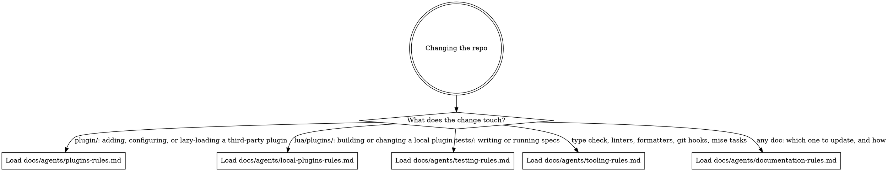

# nvim

A personal Neovim 0.12 configuration that manages plugins with the built-in `vim.pack`. It assumes its owner's machine, so not every path or tool it names exists elsewhere: the fish `nvim` wrapper, the palette file at `~/.config/palette/palette.json`, and the Dracula Pro scheme the dotfiles deploy privately.

## Finding your way

Read the code for structure. This section says where each kind of answer lives.

- `init.lua` loads the `lua/config/` modules, then Neovim sources every `plugin/**/*.lua` alphabetically, subdirectories included. Shared code lives in `lua/helpers/`, and the local plugins in `lua/plugins/`.
- Each `plugin/` file opens with its upstream repo, or `-- Local plugin (no upstream repo)`, then a line on what it does, so `head -n 2 plugin/**/*.lua` lists the plugin set.
- After `mise run deps`, `.tests/deps/<plugin>` holds each plugin's source and `doc/` at the revision `nvim-pack-lock.json` pins. Read a plugin's options there rather than recalling them.
- Neovim's own reference is `$VIMRUNTIME/doc/*.txt`; read it before guessing at an API. `nvim --clean --headless --cmd 'lua io.write(vim.env.VIMRUNTIME)' --cmd 'qa!'` prints the path.
- mini.nvim owns the picker, the file explorer (mini.files), sessions, the statusline, the statuscolumn, notifications, `vim.ui.input`, and `vim.ui.select`. snacks.nvim covers the rest, with its notifier, input, and `vim.ui.select` turned off; its own explorer stays on behind `<leader>fE`. Configure a feature in the plugin that owns it.
- `lua/plugins/README.md` indexes the local plugins and links each one's directory.
- `mise tasks` lists every task with its description.

<!-- CODEGRAPH_START -->
## CodeGraph

**First check.** If `.codegraph/` doesn't exist in this repo, ask once: *"This project doesn't have CodeGraph initialized — want me to run `codegraph init -i`?"* If they decline or skip, ignore the rest of this section.

**The habit to override.** When `.codegraph/` exists, `codegraph_*` is the default for any question about symbols, call graphs, or "how does X work" — not grep + Read. Codegraph IS the pre-built index: a full AST parse already sitting in SQLite, sub-millisecond reads. If you're about to grep for a function name or Read a file to find a definition, stop — `codegraph_search` / `codegraph_context` is one call and returns more (kind, location, signature, docstring).

Grep and Read are for **literal text** — log messages, comments, string contents — or files you already have open.

The detailed tool-selection table and common chains live in the codegraph MCP server's own instructions, which are already loaded into every session. This section adds the project-level emphasis those instructions can't carry: *when* to reach for codegraph in the first place.

### Worked example

User: *"How does auth work in this repo?"*

- **Wrong reflex**: `grep -ri "auth" .`, Read four files, maybe spawn an Explore subagent to make sense of it.
- **Right reflex**: `codegraph_context("authentication")` → if more breadth is needed, one `codegraph_explore` over the symbols it surfaced. Two calls, done. Spawning a subagent here repeats work the index already did.

### Red flags — you're about to skip codegraph

| Thought | Reality |
|---|---|
| "I'll just grep quickly to find it" | `codegraph_search` is faster and returns kind + location + signature in one call. |
| "Let me Read the file first to orient" | If you're looking up a symbol, `codegraph_node` returns just that symbol's source. |
| "I'll spawn an Explore subagent" | Codegraph IS the pre-built index — the agent would re-derive what's already indexed. |
| "Let me verify the codegraph result with grep" | Don't. AST parse beats text search; re-verifying wastes context. |
| "I'll chain `codegraph_search` then `codegraph_node`" | Use `codegraph_context` — one call instead of two. |

### Index lag

The file watcher debounces ~500ms behind writes. Don't re-query codegraph immediately after editing a file in the same turn — give it a beat, or trust your edit.
<!-- CODEGRAPH_END -->

## Rules for every change

- Run `mise run preflight` before you call a change done. It checks formatting, runs the linters and the type check, then runs the test suite, which covers everything the pre-commit and pre-push hooks check. `mise run format` fixes formatting.
- `mise run test tests/config/startup_spec.lua` is the fastest proof that the config still boots. It loads the whole config headless and fails on any error or warning, so run it after a change under `plugin/` or `lua/config/`.
- Every `nvim_create_autocmd` has a comment above it saying what it does, why it exists, and when it fires. For an autocmd that lazy-loads a plugin, the comment names the plugin and its trigger.
- Define keymaps with `require("helpers.mappings").map(desc, mode, lhs, rhs, opts)`, which takes the `desc` that which-key shows first. `require("helpers.mappings").Cmd("…")` wraps a command in `<Cmd>…<CR>`. The leader is `<Space>` and the local leader is `,`.
- Annotate public functions with LuaCATS: a one-line `---` summary, then `---@param` and `---@return`.
- Leave `nvim-pack-lock.json` to `vim.pack`, which rewrites it on every install and update.

## Routing

Read this digraph as a checklist, not a single path: load every file whose edge matches your change before you edit that area.

## Keeping docs current

When your change makes a doc wrong or incomplete, update that doc in the same change. `docs/agents/documentation-rules.md` says which doc covers what and how to edit each one. A new rule goes in this file until its area needs a rule file of its own. Add that file's edge to `## Routing` in the same change.
