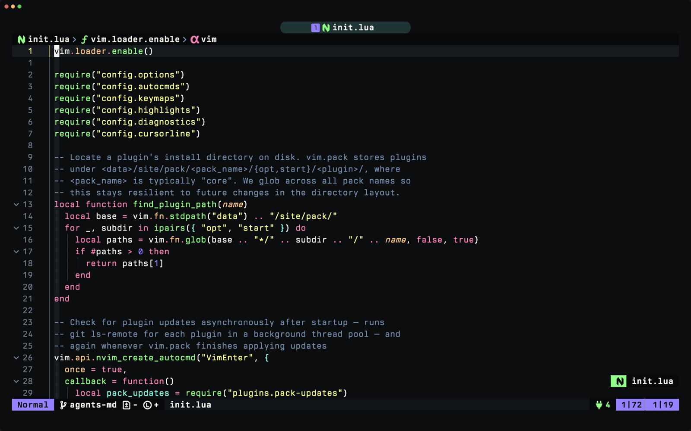

# nvim

My Neovim 0.12 config. [My dotfiles](https://github.com/macintacos/dotfiles) pull it in as
a [chezmoi](https://www.chezmoi.io/) external, so it keeps its own history. It runs in
[Ghostty](https://ghostty.org/), inside the [herdr](https://herdr.dev) agent multiplexer.

Nothing here is built for anyone else to install. There's no bootstrap, and parts of it
assume my machine: a fish wrapper around `nvim`, and the palette and color scheme my
dotfiles deploy. Take whatever looks useful.

## How it's put together

- **No third-party plugin manager.** Neovim's built-in
  [`vim.pack`](https://neovim.io/doc/user/pack.html) installs each plugin from its own
  file under `plugin/` and pins it in `nvim-pack-lock.json`. A plugin loads at startup,
  right after startup, or on its first command or keymap.
- **[mini.nvim](https://github.com/nvim-mini/mini.nvim) does most of the work.** It owns
  the picker, file explorer, sessions, statusline, and notifications.
  [snacks.nvim](https://github.com/folke/snacks.nvim) covers the rest, such as indent
  guides, the terminal, and lazygit.
- **The colors follow the terminal.** The color scheme switches between dark and light
  when the terminal does, even in a running editor.
- **It's tested and linted.** A [plenary](https://github.com/nvim-lua/plenary.nvim) spec
  suite, selene, stylua, and emmylua_check run on [hk](https://hk.jdx.dev/) git hooks.
  [mise](https://mise.jdx.dev/) pins every tool, and `mise tasks` lists the tasks.

## Local plugins

Thirteen plugins I wrote because nothing upstream did the job. Each directory has its own
README.

| Plugin | What it does |
| --- | --- |
| [`blink-omni`](lua/plugins/blink-omni/) | Bridges a buffer's `omnifunc` into the blink.cmp menu — how Ghostty's config options reach completion. |
| [`blink-pairs`](lua/plugins/blink-pairs/) | blink.pairs rules for Markdown emphasis that stay out of inline code spans, the parity check that decides when a symmetric delimiter opens a new pair, and a highlight on Markdown delimiters left without a partner. |
| [`branches`](lua/plugins/branches/) | `<leader>gb` — a centered picker over the repo's branches, local above remote, that switches to one, moves to the worktree holding it, or creates one off HEAD. |
| [`ftchooser`](lua/plugins/ftchooser/) | `<leader>fl` picks a buffer's filetype from human names; the choice is remembered per file across restarts. |
| [`gotoline`](lua/plugins/gotoline/) | `:GoToLine` — one floating prompt that fuzzy-finds a project file, previews it, then jumps to a line in it. |
| [`mini-pickers`](lua/plugins/mini-pickers/) | Replacement mini.pick registry entries: document symbols as a real tree, thinned workspace symbols, per-line blame, and an `rg` invocation whose flags are ours. |
| [`pack-pr`](lua/plugins/pack-pr/) | `:PackPR` (`<leader>Pp`) — pick an open PR of one of your `github.com/<owner>/` plugins, install its branch headlessly, and restart into it; a reset entry per plugin goes back to the default branch. |
| [`pack-tweaks`](lua/plugins/pack-tweaks/) | `<CR>` on a line in the `vim.pack` update buffer opens that commit or tag in the browser. |
| [`pack-updates`](lua/plugins/pack-updates/) | A statusline count of plugins with upstream commits you haven't pulled, checked in the background with `git ls-remote` and cached for a day; `<leader>Pc` re-checks. |
| [`projects`](lua/plugins/projects/) | `<leader>pp` — a [zoxide](https://github.com/ajeetdsouza/zoxide) picker that relaunches Neovim in the directory you choose, session and all. |
| [`scratch`](lua/plugins/scratch/) | `<leader>wt` — per-project scratch files under `.tmp/scratch/`, picked or named on open. |
| [`uv-scripts`](lua/plugins/uv-scripts/) | Filetype detection and a `ty` client pointed at the environment [uv](https://docs.astral.sh/uv/guides/scripts/) builds for a PEP 723 single-file script. |
| [`worktrunk`](lua/plugins/worktrunk/) | `<leader>gw` — [worktrunk](https://worktrunk.dev) from a float: my shell's worktree picker, quick switches, remove and merge, relaunching Neovim in whichever worktree they land in; plus this file's copy from another worktree, split or diffed; and a worktree removed from under Neovim moves it into the primary one. |
