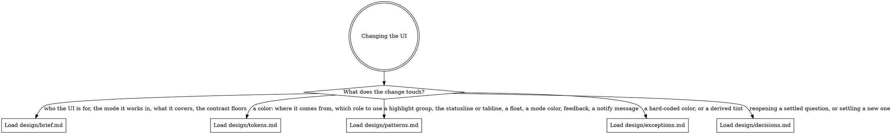

# Design

This directory holds the design direction for the editor's UI. Every change to the config's colors, chrome, floats, or messages follows it.

## Routing

Read this digraph as a checklist: load every file whose edge matches your change.

## Keeping design/ current

When a change adds a pattern or departs from one, update the matching file in the same change. A pattern goes in `patterns.md`, and a deliberate departure from the palette rules goes in `exceptions.md` with its reason.

When you settle a direction question, add a dated entry to `decisions.md`. When you add a file to `design/`, give it an edge in `## Routing`.
