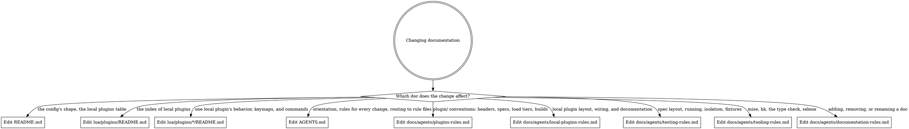

# Documentation rules

Read this digraph as a checklist: edit every doc whose edge matches your change.

## The doc landscape

- **`README.md`** introduces the config to a person curious about the setup: the preview recording, how plugins load, what mini.nvim and snacks.nvim each own, and the local plugins table. Keep it minimal, and let the recording stand without a walkthrough. Write in the first person, as the repo's owner, and hard-wrap prose at about 90 columns like the rest of the file. It changes when a local plugin is added, renamed, or removed (with `lua/plugins/README.md`), and when a job moves between mini and snacks (with `AGENTS.md`).
- **`lua/plugins/README.md`** indexes the local plugins for a person browsing `lua/plugins/`: one alphabetical bullet per plugin, linking its directory and giving its purpose in a sentence. Keep its plugins the same as the rows of `README.md`'s table, which changes with it.
- **`lua/plugins/*/README.md`** documents one local plugin for a person using it: what it does, its keymaps and commands, and the design choices behind it. Edit the section the change affects and keep the file's existing headings. It changes with that plugin's behavior, keymaps, or commands.
- **`AGENTS.md`** is the file every agent loads first: what the repo is, where answers live, the rules every change needs, and the routing digraph. Keep it to rules that apply to every change, plus the rules of any area that has no rule file yet. It changes when a rule file is added, renamed, or removed, which updates its `## Routing` edge.
- **`docs/agents/*-rules.md`** each hold one area's rules, which agents load through `AGENTS.md`'s routing when a change touches that area. State each rule as an instruction, and point to a file in the repo that follows it. A rule file changes when its area's conventions change.
- **`docs/agents/documentation-rules.md`**, this file, maps every doc to what it covers. Each doc gets one box in the digraph and one bullet here.

## Adding a doc

A new doc goes beside what it describes:

- A new local plugin's `README.md` goes in its directory, `lua/plugins/<name>/`.
- A rule for an area starts in `AGENTS.md`. Once the area has rules that changes elsewhere do not need, they move to `docs/agents/<area>-rules.md`, with an edge in `AGENTS.md`'s `## Routing`.

Adding, removing, or renaming a doc updates this file's digraph and landscape in the same change.
